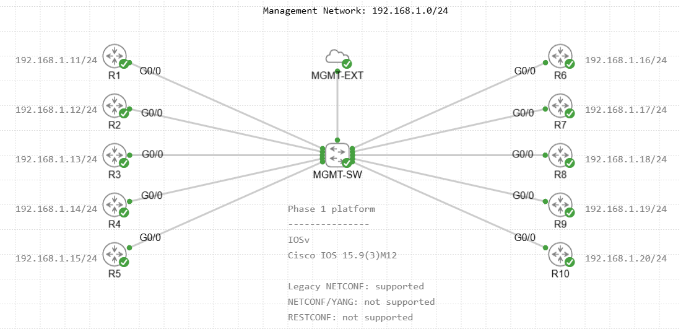
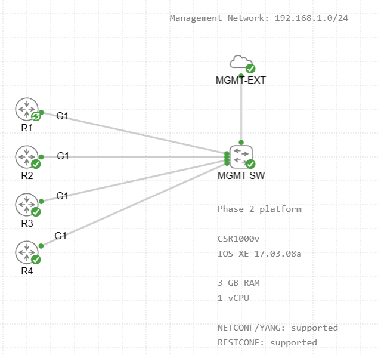

# Cisco CML Network Automation Benchmark

Benchmarking Python network automation approaches for **retrieving and backing up Cisco device configurations** in Cisco Modeling Labs (CML) 2.10.1 — from a plain sequential SSH loop to model-driven NETCONF/YANG and RESTCONF.

The goal is **not** to crown a universal winner. It is to document how complete automation stacks (library + transport + protocol + concurrency model + runtime) behave under a controlled, reproducible lab workload.

---

## At a Glance

| | Phase 1 — CLI & legacy automation | Phase 2 — Model-driven automation |
|---|---|---|
| Platform | 10 × Cisco IOSv — IOS 15.9(3)M12 | 4 × Cisco CSR1000v — IOS XE 17.03.08a |
| Workload | `show running-config` over SSH (and legacy NETCONF) | `Cisco-IOS-XE-native:native` via NETCONF and RESTCONF |
| Concurrency levels | 1, 2, 4, 5, 10 | 1, 2, 4 (3 runs each) |
| Methods | 7 | 2 |
| Details | [src/phase1/](src/phase1/README.md) | [src/phase2/](src/phase2/README.md) |

> The two phases use different platforms and topology sizes. Their numbers are **not** directly comparable — see [Benchmark caveats](docs/methodology.md#benchmark-fairness-and-caveats).

---

## Lab Topologies

| Phase 1 — 10 × IOSv | Phase 2 — 4 × CSR1000v |
|---|---|
|  |  |
| ⬇️ [phase1-iosv-10-routers.yaml](cml/topologies/phase1-iosv-10-routers.yaml) | ⬇️ [phase2-csr1000v-4-routers.yaml](cml/topologies/phase2-csr1000v-4-routers.yaml) |

Both topologies can be imported directly into CML — see [Importing the topologies](docs/lab-environment.md#importing-the-topologies-into-cml).

> [!NOTE]
> The topology files and the router configs in [`cml/`](cml/) intentionally include the lab credentials (user `automation`, password/enable secret `cisco`) so the labs boot ready to use. They are published on purpose because this is an **isolated lab environment**. Never reuse these credentials outside a lab, and change them if your CML is reachable from other networks.

---

## Methods

Each method lives in its own folder under `src/` with a dedicated README covering the implementation, how to run it, detailed results and method-specific findings.

### Phase 1 — 10 × IOSv

| # | Method | Execution model | Best wall time (10 devices) | Docs |
|---:|---|---|---:|---|
| 1 | Netmiko | Sequential | 12.226 s | [sequential](src/phase1/sequential/README.md) |
| 2 | Netmiko | `threading.Thread` (1 per device) | 1.691 s | [threading](src/phase1/threading/README.md) |
| 3 | Netmiko | `ThreadPoolExecutor` | 1.766 s | [threadpool](src/phase1/threadpool/README.md) |
| 4 | Scrapli + AsyncSSH | `asyncio` + semaphore | **1.456 s** | [asyncio](src/phase1/asyncio/README.md) |
| 5 | Nornir + Netmiko | Nornir threaded runner | 1.578 s | [nornir](src/phase1/nornir/README.md) |
| 6 | pyATS + Unicon (WSL2) | `ThreadPoolExecutor` | 3.288 s | [pyats](src/phase1/pyats/README.md) |
| 7 | Legacy NETCONF + ncclient | `ThreadPoolExecutor` | 1.745 s | [netconf](src/phase1/netconf/README.md) |

### Phase 2 — 4 × CSR1000v

| # | Method | Transport / encoding | Wall time @ 1 → 4 workers | Docs |
|---:|---|---|---:|---|
| 1 | NETCONF/YANG + ncclient | SSH TCP/830 · XML | 3.388 s → 0.868 s | [netconf_yang](src/phase2/netconf_yang/README.md) |
| 2 | RESTCONF + requests | HTTPS/443 · YANG JSON | 1.959 s → **0.497 s** | [restconf](src/phase2/restconf/README.md) |

---

## Key Findings

- **Concurrency is the biggest lever.** The I/O-bound backup workload drops from ~12.2 s sequential to ~1.5–1.8 s with 10 concurrent sessions (~7× speedup).
- **The concurrency model alone does not explain performance.** Library, transport, session setup and framework defaults matter just as much — Scrapli + AsyncSSH + asyncio was fastest in Phase 1, but that is a whole-stack result, not proof that "asyncio beats threads".
- **Nornir's orchestration added no visible overhead** over a hand-written thread pool.
- **pyATS + Unicon is heavier per session**, and its defaults (disconnect waits, init config commands) had to be tuned to get a fair, read-only benchmark.
- **Legacy NETCONF ≠ NETCONF/YANG.** IOSv returns CLI text wrapped in XML; IOS XE returns a real YANG tree.
- **RESTCONF was ~41–43% faster than NETCONF/YANG** in Phase 2 with near-identical payload sizes; both scaled almost linearly (≈98% efficiency at 4 workers).
- **Host RAM, not code, capped the Phase 2 lab** at four CSR1000v nodes.

Full list: [docs/lessons-learned.md](docs/lessons-learned.md).

---

## Quick Start

```powershell
# 1. Create the Windows environment
python -m venv .venv
.\.venv\Scripts\Activate.ps1
pip install -r requirements.txt

# 2. Create your inventory from the examples
copy inventory\phase1\devices.example.yaml     inventory\phase1\devices.yaml
copy inventory\phase1\credentials.example.yaml inventory\phase1\credentials.yaml
#    (same for inventory\phase2\)

# 3. Run a benchmark from the repository root
python .\src\phase1\threadpool\netmiko_threadpool_benchmark.py
python .\src\phase2\restconf\restconf_benchmark.py --workers all --runs 3
```

Each run writes timestamped output:

```text
backups/<phase>/<method>/<run_id>/   → saved configurations (.cfg / .xml / .json)
results/<phase>/<method>/<run_id>/results.csv → per-device metrics
```

Both folders are git-ignored; a sample run for every method is committed in [examples/](examples/README.md).

pyATS runs under WSL2 and some packages are version-pinned for the legacy IOSv SSH stack — see [docs/setup.md](docs/setup.md) before running.

---

## Repository Layout

```text
cml-network-automation-benchmark/
├── README.md                 ← you are here
├── LICENSE                   ← MIT
├── requirements.txt          ← Windows environment (Phase 1 SSH + Phase 2)
├── requirements-wsl.txt      ← WSL2 environment (pyATS / Unicon / Genie)
├── cml/                      ← importable CML topologies, router bootstrap configs, validation notes
├── docs/                     ← cross-cutting documentation (lab, setup, methodology, lessons) + images
├── inventory/
│   ├── phase1/               ← devices.yaml / credentials.yaml (+ .example files)
│   └── phase2/
├── src/
│   ├── phase1/               ← sequential · threading · threadpool · asyncio · nornir · pyats · netconf
│   └── phase2/               ← netconf_yang · restconf
├── examples/                 ← one sample run per method (backups + results.csv)
├── backups/                  ← generated per run (git-ignored)
└── results/                  ← generated per run (git-ignored)
```

---

## Documentation

| Document | Contents |
|---|---|
| [docs/lab-environment.md](docs/lab-environment.md) | CML / Hyper-V setup, topologies, addressing, router bootstrap configs, troubleshooting |
| [docs/setup.md](docs/setup.md) | Python environments (Windows + WSL2), inventory and credentials, version pins, legacy SSH compatibility |
| [docs/methodology.md](docs/methodology.md) | Workload, timing, metrics, CSV schema, terminology, output differences, caveats |
| [docs/lessons-learned.md](docs/lessons-learned.md) | Lessons learned, overall conclusion, roadmap |
| [src/phase1/README.md](src/phase1/README.md) | Phase 1 comparison across all seven methods |
| [src/phase2/README.md](src/phase2/README.md) | Phase 2 NETCONF/YANG vs RESTCONF comparison |

---

## License

Released under the [MIT License](LICENSE).

Cisco IOSv, CSR1000v and Cisco Modeling Labs are Cisco software and are not covered by this license; no Cisco images are included in this repository.
